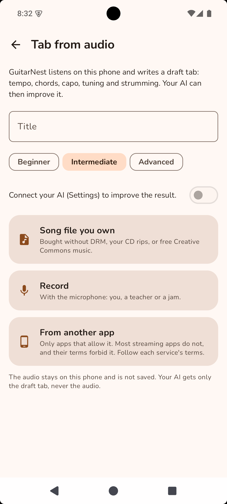

# GuitarNest

[](https://github.com/0x0SegFault/guitarnest/actions/workflows/build.yml)
[](https://github.com/0x0SegFault/guitarnest/actions/workflows/ios.yml)
[](https://github.com/0x0SegFault/guitarnest/actions/workflows/ai.yml)
[](LICENSE)

A free and open-source app to learn songs on the guitar, for **Android and iPhone**: tabs, strumming patterns, metronome and tuner, and tabs made from your own audio. No account, no ads, no trackers. Works without Google services. Your songs stay on your phone.

**Status: early development.** No release yet.

<p>
  
  
  
  
  
  
</p>

| Platform | App | Status |
|---|---|---|
| Android 8+ | `app/` (Kotlin, Jetpack Compose) | Built, tested on the emulator |
| iPhone, iOS 17+ | `ios/` (SwiftUI) | Built and tested by CI on macOS; screenshots in the `ios-preview` release |
| Shared logic | `shared/` (Kotlin Multiplatform) | Tab format, music analysis, note model, AI requests |

## Features

- **Tab library**: write tabs and strumming patterns; import GuitarNest (`.gnt`) and MusicXML files; export, print or save as PDF.
- **Tab from audio**: a song file you own, a recording of you playing, or (Android) the sound of an app that allows capture becomes a draft tab with tempo, chords, capo, tuning and strumming, at your level. The notes are found **on your phone** (Basic Pitch model, no internet needed).
- **Play along**: the current bar and strum light up with the metronome; count-in, loop a section, play at 50–100 % or speed up step by step.
- **Metronome**: 30–250 BPM, accents, subdivisions, tap tempo, speed trainer, strumming patterns.
- **Tuner**: 9 tunings; the string being tuned lights up.
- **Your own AI** (optional): connect a cloud account (Anthropic, OpenAI, Mistral, OpenRouter), your gateway (LiteLLM) or a local model (Ollama, LM Studio). It improves drafts, arranges a tab for your level or adds strumming patterns. Only the tab and your request are sent, to the address you choose; never audio.
- **Song search** in MusicBrainz (open data) to start a new tab.
- **Encrypted backups**: one password-protected file with all songs and practice history, where you want it. Android and iPhone use the same format.
- **AI toolkit** for your computer ([ai/](ai/README.md)): the same analysis from the command line, with a skill file for AI agents.
- English, French, German, Spanish, Italian.

## Privacy and copyright

- The app sends data only when you search or ask your AI, and only what [PRIVACY.md](PRIVACY.md) lists.
- Never downloads audio, and has no song or tab database. Tabs come from you: written by you, imported from files you own, or made from your own recordings. See [docs/COPYRIGHT.md](docs/COPYRIGHT.md).

## How it works

- Music logic in a Kotlin Multiplatform module (`shared/`), with tests: pitch detection (YIN), tab format, text tabs, MusicXML import, metronome timing, AI answer checks.
- Tab format: [docs/TAB_FORMAT.md](docs/TAB_FORMAT.md). Sources and methods: [docs/SCIENCE.md](docs/SCIENCE.md). Plan: [docs/ROADMAP.md](docs/ROADMAP.md).
- Audio-to-tab accuracy and limits: [research/transcription/](research/transcription/README.md).

## Build

Android: JDK 17+ and the Android SDK (platform 36).

```sh
./gradlew :shared:jvmTest assembleDebug
```

iPhone (macOS with Xcode 16): see [ios/README.md](ios/README.md).

Releases and stores: [docs/RELEASING.md](docs/RELEASING.md), [docs/STORES.md](docs/STORES.md).

## Contribute

Bug reports, translations and code are welcome. See [CONTRIBUTING.md](CONTRIBUTING.md).

## AI-assisted

This project is developed with AI assistance. The maintainer reviews, tests and is responsible for all code.

## License

[GPL-3.0-or-later](LICENSE). Font: Nunito ([OFL](LICENSE-font-Nunito.txt)). Basic Pitch note model: Apache-2.0, Spotify ([licence](models/LICENSE-basic-pitch.txt)).
