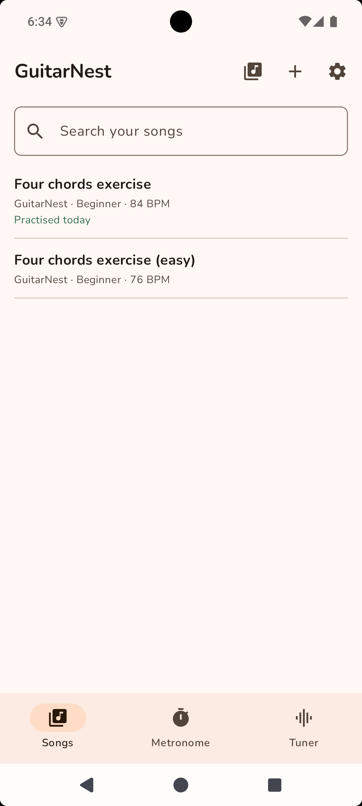
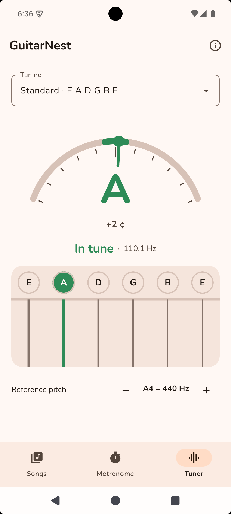

# GuitarNest

[](https://github.com/0x0SegFault/guitarnest/actions/workflows/build.yml)
[](https://github.com/0x0SegFault/guitarnest/actions/workflows/ai.yml)
[](LICENSE)

A free and open-source app to learn songs on the guitar: tabs, strumming patterns, metronome and tuner. No account, no ads, no trackers. Works without Google services. Your songs stay on your phone.

**Status: early development.** No release yet.

<p>
  
  
  
  
  
</p>

## Features

- **Tab library**: write tabs and strumming patterns, import GuitarNest (`.gnt`) and MusicXML (`.musicxml`, `.mxl`) files, export, print or save as PDF.
- **Play along**: the current bar and strum light up with the metronome; count-in, loop a section, play at 50–100 % or speed up step by step.
- **Metronome**: 30–250 BPM, accents, subdivisions, tap tempo, speed trainer, strumming patterns.
- **Tuner**: 9 tunings; the string being tuned lights up.
- **Your own AI** (optional): connect any OpenAI-compatible model (local Ollama or LM Studio, your LiteLLM gateway, or a cloud account). It arranges a tab for your level or adds strumming patterns. Only the song and your request are sent, to the address you choose.
- **AI toolkit** for your computer: makes a tab from your own recording, with tempo, chords, capo, tuning and strumming ([ai/](ai/README.md)).
- **Song search** in MusicBrainz (open data) to start a new tab.
- English, French, German, Spanish, Italian.

## Privacy and copyright

- The app sends data only when you search or ask your AI, and only what [PRIVACY.md](PRIVACY.md) lists.
- No song or tab database. Tabs come from you: written by you, imported from files you own, or made from your own recordings. See [docs/COPYRIGHT.md](docs/COPYRIGHT.md).

## How it works

- Music logic in a Kotlin Multiplatform module (`shared/`), with tests: pitch detection (YIN), tab format, text tabs, MusicXML import, metronome timing, AI answer checks.
- Tab format: [docs/TAB_FORMAT.md](docs/TAB_FORMAT.md). Sources and methods: [docs/SCIENCE.md](docs/SCIENCE.md). Plan: [docs/ROADMAP.md](docs/ROADMAP.md).
- Audio-to-tab accuracy and limits: [research/transcription/](research/transcription/README.md).

## Build

Requirements: JDK 17+ and the Android SDK (platform 36).

```sh
./gradlew :shared:jvmTest assembleDebug
```

## Contribute

Bug reports, translations and code are welcome. See [CONTRIBUTING.md](CONTRIBUTING.md).

## AI-assisted

This project is developed with AI assistance. The maintainer reviews, tests and is responsible for all code.

## License

[GPL-3.0-or-later](LICENSE). Font: Nunito ([OFL](LICENSE-font-Nunito.txt)). Basic Pitch model (AI toolkit, downloaded separately): Apache-2.0, Spotify.
