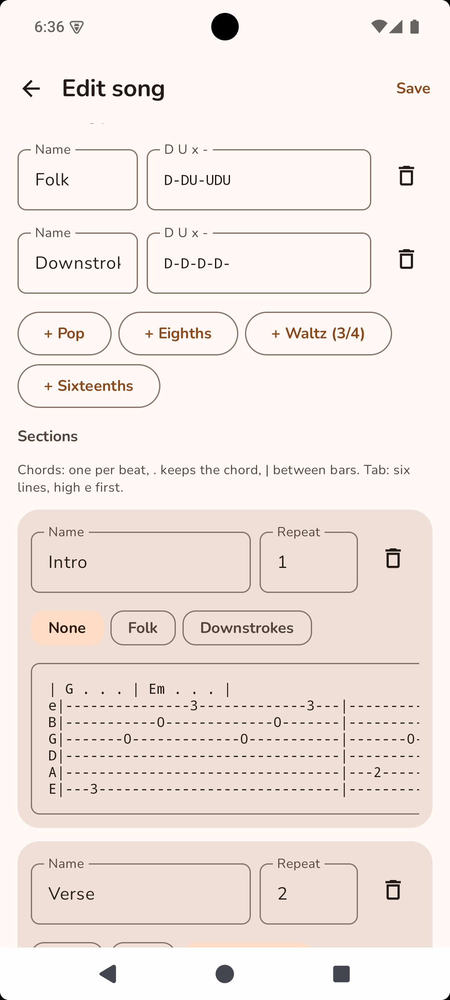
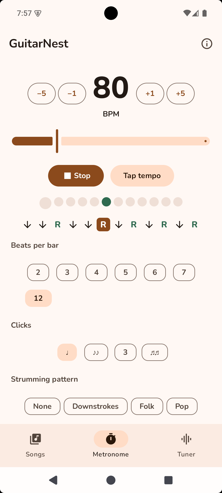
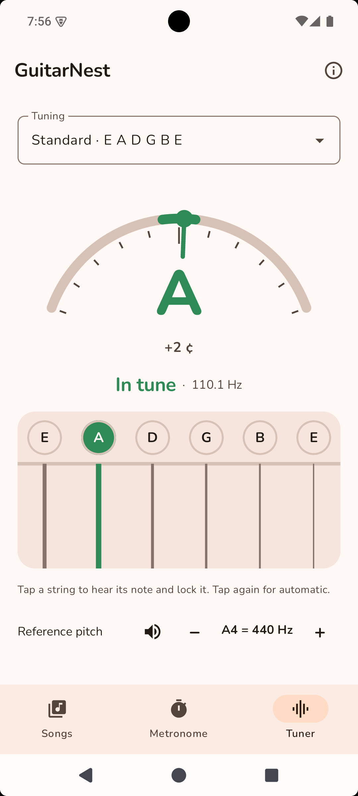
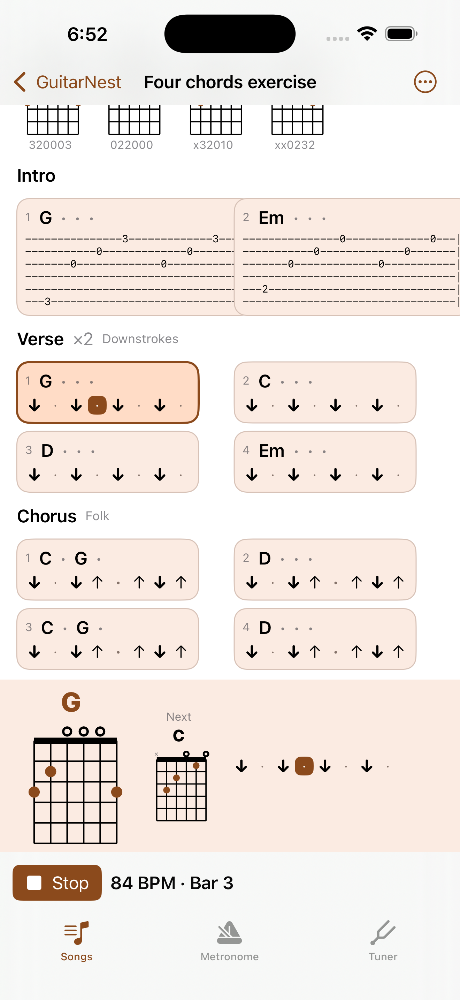
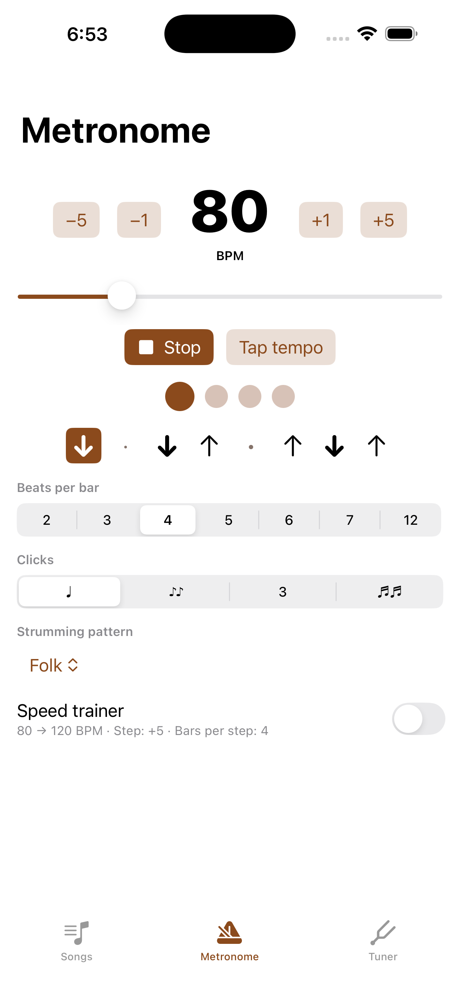
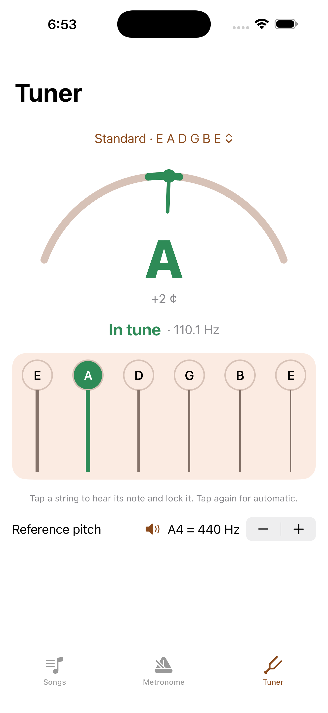
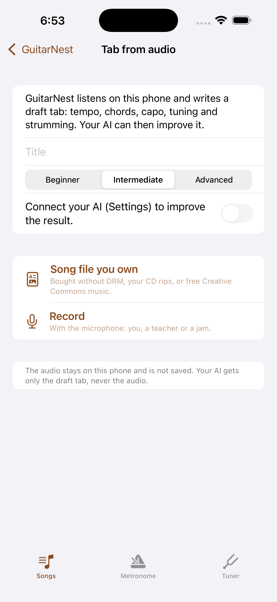

# GuitarNest

[](https://github.com/0x0SegFault/guitarnest/actions/workflows/build.yml)
[](https://github.com/0x0SegFault/guitarnest/actions/workflows/ios.yml)
[](https://github.com/0x0SegFault/guitarnest/actions/workflows/ai.yml)
[](LICENSE)

A free and open-source app to learn songs on the guitar, for **Android and iPhone**: tabs, strumming patterns, metronome and tuner, and tabs made from your own audio. No account, no ads, no trackers. Works without Google services. Your songs stay on your phone.

**Status: early development.** No release yet.

<p>
  
  
  
  
  
  
</p>

iPhone (from the CI simulator):

<p>
  
  
  
  
</p>

| Platform | App | Status |
|---|---|---|
| Android 8+ | `app/` (Kotlin, Jetpack Compose) | Built, tested on the emulator |
| iPhone, iOS 17+ | `ios/` (SwiftUI) | Builds and passes its tests in CI on macOS |
| Shared logic | `shared/` (Kotlin Multiplatform) | Tab format, music analysis, note model, AI requests |

## Features

- **Song book**: 24 public-domain songs arranged for GuitarNest (Ode to Joy, Greensleeves, Amazing Grace, Silent Night, Minuet in G…), each at three levels: chords and strumming, melody with chords, or fingerstyle. No lyrics. Works offline.
- **Free scores**: search finds guitar scores in the public domain or under Creative Commons (Mutopia Project: Sor, Carulli, Giuliani, Bach…) and makes a tab in one tap. The list is in the app; a score is downloaded only when you tap it.
- **Chords with your AI**: for other songs, your own AI writes a chord chart (chords, sections, strumming), never lyrics or melody, marked as a draft to check by ear.
- **Tab library**: write tabs and patterns; import GuitarNest (`.gnt`), MusicXML and MIDI files ([free music to import](docs/OPEN_MUSIC.md)); export, print or save as PDF.
- **Tab from audio**: a song file you own, a recording of you playing, or (Android) the sound of an app that allows capture becomes a draft tab with tempo, chords, capo, tuning and strumming, at your level. The notes are found **on your phone** (Basic Pitch model, no internet needed).
- **Play along**: the current bar and strum light up with the metronome; the chord now and next are shown as diagrams; with fingerpicking the string to pick lights up. Count-in, loop a section, play at 50–100 % or speed up step by step.
- **Chord diagrams**: computed for every chord, open and barre shapes up the neck; choose the one you play. Printed with the tab.
- **Strumming and fingerpicking patterns**, including flamenco (rumba, tangos, garrotín, rasgueado, sevillanas, fandango de Huelva, tanguillo, and the soleá, alegrías, bulerías, guajira and seguiriya compás) and a muted backbeat for rumba and island pop.
- **Metronome**: 30–250 BPM, accents, subdivisions, tap tempo, speed trainer, strumming patterns.
- **Tuner**: 9 tunings; the string being tuned lights up; tap a string to hear its note; reference A4 as a tuning fork.
- **Your own AI** (optional): connect a cloud account (Anthropic, OpenAI, Mistral, OpenRouter), your gateway (LiteLLM) or a local model (Ollama, LM Studio). It improves drafts, arranges a tab for your level or adds strumming patterns. Only the tab and your request are sent, to the address you choose; never audio.
- **Song search** in MusicBrainz (open data) to start a new tab, with free scores and chords from your AI.
- **Find the title** of a recording with AcoustID (optional, off by default). Only a fingerprint of the sound is sent.
- **Report a problem or idea** anonymously (EU-hosted, nothing about you kept) or on GitHub.
- **Encrypted backups**: one password-protected file with all songs and practice history, where you want it. Android and iPhone use the same format.
- **AI toolkit** for your computer ([ai/](ai/README.md)): the same analysis from the command line, with a skill file for AI agents.
- English, French, German, Spanish, Italian.

## Privacy and copyright

- The app sends data only when you search or ask your AI, and only what [PRIVACY.md](PRIVACY.md) lists.
- Never downloads audio, and has no song or tab database. Tabs come from you: written by you, imported from files you own, or made from your own recordings. See [docs/COPYRIGHT.md](docs/COPYRIGHT.md).

## How it works

- Music logic in a Kotlin Multiplatform module (`shared/`), with tests: pitch detection (YIN), tab format, text tabs, MusicXML import, metronome timing, AI answer checks.
- Tab format: [docs/TAB_FORMAT.md](docs/TAB_FORMAT.md). Sources and methods: [docs/SCIENCE.md](docs/SCIENCE.md). Plan: [docs/ROADMAP.md](docs/ROADMAP.md).
- Audio-to-tab accuracy and limits: [research/transcription/](research/transcription/README.md).

## Build

Android: JDK 17+ and the Android SDK (platform 36).

```sh
./gradlew :shared:jvmTest assembleDebug
```

iPhone (macOS with Xcode 16): see [ios/README.md](ios/README.md).

Releases: [docs/RELEASING.md](docs/RELEASING.md).

## Contribute

Bug reports, translations and code are welcome. See [CONTRIBUTING.md](CONTRIBUTING.md).

## Credits

GuitarNest uses free software, open data and published research. The main parts:
- [Basic Pitch](https://github.com/spotify/basic-pitch) (Spotify, Apache-2.0): the note detection model.
- [Kotlin Multiplatform](https://kotlinlang.org), [Jetpack Compose](https://developer.android.com/compose) and SwiftUI: the apps.
- [MusicBrainz](https://musicbrainz.org) (CC0 data): song search.
- [Chromaprint](https://github.com/acoustid/chromaprint) (MIT) and [AcoustID](https://acoustid.org): song identification.
- [Nunito](https://github.com/googlefonts/nunito) (OFL-1.1): the font.

[CREDITS.md](CREDITS.md) gives the full list with licences. The app shows the same list in About and permissions → Open-source credits.

## AI-assisted

This project is developed with AI assistance. The maintainer reviews, tests and is responsible for all code.

## License

[EUPL-1.2](LICENSE), the open-source licence of the European Union. Font: Nunito ([OFL](LICENSE-font-Nunito.txt)). Basic Pitch note model: Apache-2.0, Spotify ([licence](models/LICENSE-basic-pitch.txt)).
