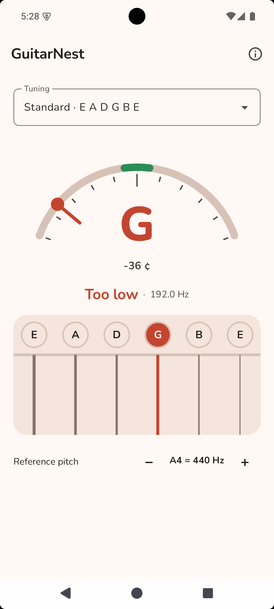

# GuitarNest

[](https://github.com/0x0SegFault/guitarnest/actions/workflows/build.yml)
[](LICENSE)

A free and open-source app to learn songs on the guitar: tabs, strumming patterns, metronome and tuner. Offline, no account, no ads, no trackers. Works without Google services.

**Status: early development.** The tuner works. No release yet.

<p>
  
  
  
  
</p>

## Features

| Now | Next |
|---|---|
| Tuner: 9 tunings, the string being tuned lights up | Metronome |
| Tap a string to lock it | Strumming patterns that play with the metronome |
| Reference pitch 415–466 Hz | Tabs: import (Guitar Pro, MusicXML), play along, slow down, loop, print |
| English, French, German, Spanish, Italian | Draft tabs from your own audio, with tuning, capo and strumming |

## Privacy

- No internet permission. The app cannot send anything.
- The microphone works only while the tuner is open. Nothing is recorded.
- No song database: you work only with music you own. See [docs/COPYRIGHT.md](docs/COPYRIGHT.md).

Details: [PRIVACY.md](PRIVACY.md).

## How it works

- Pitch detection: YIN algorithm, in a Kotlin Multiplatform module (`shared/`) with tests on synthetic guitar sounds.
- Tabs from audio: a research prototype measures what is possible today. Results and limits: [research/transcription/](research/transcription/README.md).
- All sources: [docs/SCIENCE.md](docs/SCIENCE.md).

## Build

Requirements: JDK 17+ and the Android SDK (platform 36).

```sh
./gradlew :shared:jvmTest assembleDebug
```

## Contribute

Bug reports, translations and code are welcome. See [CONTRIBUTING.md](CONTRIBUTING.md).

## AI-assisted

This project is developed with AI assistance. The maintainer reviews, tests and is responsible for all code.

## License

[GPL-3.0-or-later](LICENSE). Font: Nunito ([OFL](LICENSE-font-Nunito.txt)). Basic Pitch model (research only): Apache-2.0, Spotify.
